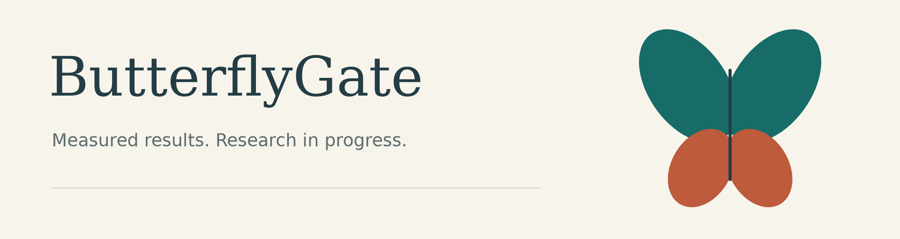
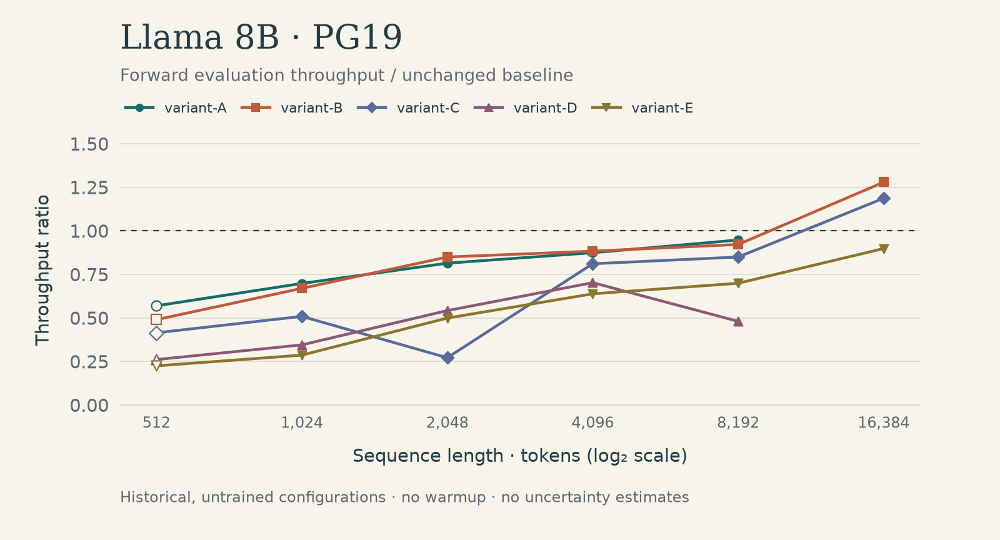

# ButterflyGate

Exploratory forward-pass measurements of experimental token-mixing replacements in pretrained language models.

[](https://github.com/kanishkpaul/butterflygate/actions/workflows/ci.yml)
[](LICENSE)

**Results preview · untrained configurations · implementation private**

Some configurations recorded higher throughput at longer contexts. Predictive quality remains unresolved: the Llama replacement paths show severe degradation, and no completed training result is included. These measurements do not establish a useful drop-in replacement for attention.

[Browse the experiments](results/README.md) · [Measurement protocol](docs/measurement-protocol.md) · [Limitations](docs/limitations.md) · [Release scope](docs/release-scope.md)

## The released experiments

| Experiment | Data | Measured coverage | What is available |
| :--- | :--- | :--- | :--- |
| [Gemma E2B](results/gemma-dolma/README.md) | Dolma sample | 512–14,336 tokens | Main sweep, longer probes, repeated attempts, failures |
| [Llama 1B](results/llama1b-dolma/README.md) | Dolma sample | 512–32,768 tokens | Throughput, memory, loss, perplexity, accuracy, failures |
| [Llama 8B](results/llama8b-pg19/README.md) | PG19 validation | All configurations through 8,192; partial at 16,384 | Five anonymous configurations, quality metrics, quota status |

All are historical measurements from May 2026: batch size 1, `bf16`, forward-only evaluation on Hugging Face ZeroGPU. Configuration labels are local to each experiment. They do not identify a mechanism or imply that configurations match across models.

## Gemma E2B / Dolma


At 1,024 and 2,048 tokens the experimental configuration is slower. From 4,096 through 14,336, its recorded throughput ratio ranges from **1.05× to 1.35×**. The 512-token observation is especially sensitive to cold-run effects and should not be quoted as an established speedup.

[Results and interpretation](results/gemma-dolma/README.md) · [Primary CSV](results/gemma-dolma/measurements.csv) · [Additional probes](results/gemma-dolma/additional-probes.csv)

## Llama 1B / Dolma


The experimental configuration records **2.22×** baseline throughput at 4,096 tokens, narrowing to **1.15×** at 32,768. At 4,096 tokens, recorded perplexity rises from **10.95 to 10,495.99**. Throughput alone does not demonstrate useful model performance.

[Results, quality, and memory](results/llama1b-dolma/README.md) · [CSV](results/llama1b-dolma/measurements.csv)

## Llama 8B / PG19



Every experimental configuration is slower through 8,192 tokens. At 16,384, variant-B records **1.28×**, variant-C **1.19×**, and variant-E **0.90×** baseline throughput. Variants A and D have no measured row at that length because quota blocked the attempts. Predictive quality is poor across the untrained replacement paths.

[Every configuration, quality, and run status](results/llama8b-pg19/README.md) · [CSV](results/llama8b-pg19/measurements.csv) · [Coverage](results/llama8b-pg19/coverage.csv)

## How to read these results

- **Historical observations.** There were no warmup passes. Models were reloaded between rows; timing includes transfers and metric calculations. Repetition is limited and uncertainty estimates are unavailable.
- **Forward evaluation.** These are not cached generation, training-throughput, or validated language-model benchmark results.
- **Incomplete runs stay incomplete.** Allocator assertions, quota blocks, and unattempted lengths are recorded separately. No failure is converted into a timing value.
- **Implementation withheld.** The tables and figures are inspectable; the private model experiments cannot be independently reproduced from this repository.

See the [protocol](docs/measurement-protocol.md) and [limitations](docs/limitations.md) before quoting a ratio.

## Work with the public artifacts

Regenerate every figure and validate the released tables without a GPU:

```bash
python -m pip install -r requirements-figures.txt
python scripts/validate_results.py
python scripts/plot_results.py
```

The optional [generic block benchmark](benchmark/README.md) accepts a user-supplied module. It is independent of the historical full-model experiments and includes no ButterflyGate implementation.

## Repository guide

| Directory | Contents |
| :--- | :--- |
| [`results/`](results/README.md) | Three experiment folders, measurement conditions, provenance, and checksums |
| [`figures/`](figures/README.md) | PNG and SVG figures generated from the public tables |
| [`docs/`](docs/README.md) | Protocol, limitations, release scope, and data definitions |
| [`scripts/`](scripts/) | Public-data validation and figure generation |
| [`benchmark/`](benchmark/README.md) | Independent, mechanism-agnostic block benchmark |

Research by [Kanishk Paul](https://kanishkpaul.com). [Citation](CITATION.cff) · [MIT license](LICENSE)
