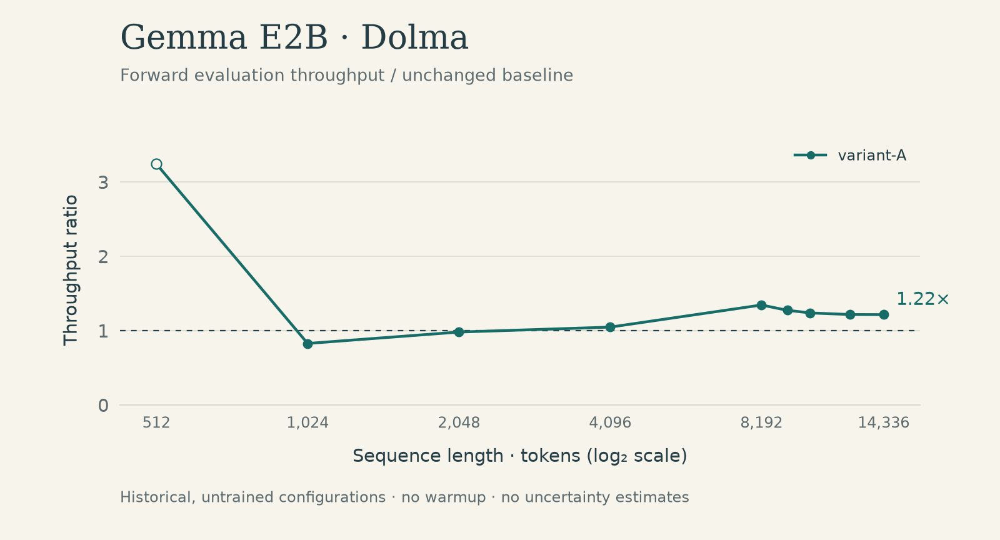
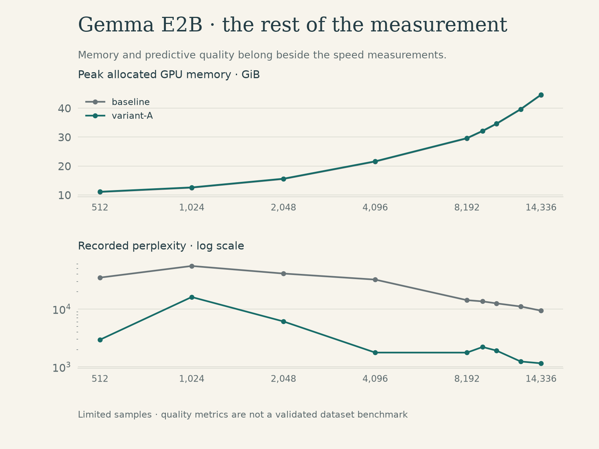

# Gemma E2B / Dolma

[Experiment index](../README.md) · [Measurement CSV](measurements.csv) · [Conditions](metadata.json)

`google/gemma-4-E2B-it` on `allenai/dolma:v1_6-sample` · 2026-05-24 UTC · batch 1 · `bf16` · forward evaluation · untrained replacements.

The primary table includes the short sweep, the recorded 8,192-token guarded probe, fresh longer probes, and the fresh 16,384-token failure. The additional-probe appendix preserves repeated sequential sweeps separately. The selection follows the previously public curve; it is not a search for the fastest repetition.

Recorded quality values require scoring validation: the baseline perplexities are very high, and these rows contain no token-accuracy field. No modeling-quality benefit is claimed.

## Throughput and memory

Peak memory is allocated GPU memory in GiB; it is not total device use. Failed rows have no metric values.

| Tokens | Configuration | tok/s | Peak GiB | Status |
| ---: | :--- | ---: | ---: | :--- |
| 512 | baseline | 2,358.85 | 11.03 | measured |
| 512 | variant-A | 7,648.54 | 11.12 | measured |
| 1,024 | baseline | 13,094.69 | 12.53 | measured |
| 1,024 | variant-A | 10,839.31 | 12.63 | measured |
| 2,048 | baseline | 11,626.35 | 15.54 | measured |
| 2,048 | variant-A | 11,407.34 | 15.63 | measured |
| 4,096 | baseline | 8,687.44 | 21.54 | measured |
| 4,096 | variant-A | 9,100.98 | 21.64 | measured |
| 8,192 | baseline | 4,261.60 | 29.55 | measured |
| 8,192 | variant-A | 5,731.71 | 29.65 | measured |
| 9,216 | baseline | 3,986.01 | 32.06 | measured |
| 9,216 | variant-A | 5,079.29 | 32.15 | measured |
| 10,240 | baseline | 3,728.28 | 34.56 | measured |
| 10,240 | variant-A | 4,616.90 | 34.65 | measured |
| 12,288 | baseline | 3,398.40 | 39.57 | measured |
| 12,288 | variant-A | 4,136.15 | 39.65 | measured |
| 14,336 | baseline | 3,115.77 | 44.57 | measured |
| 14,336 | variant-A | 3,787.82 | 44.66 | measured |
| 16,384 | baseline | — | — | allocator_failure |
| 16,384 | variant-A | — | — | allocator_failure |

## Recorded predictive quality

Perplexity and accuracy are limited-sample measurements of untrained configurations. A missing accuracy value was not recorded; it is not zero.

| Tokens | Configuration | Loss | Perplexity | Next-token accuracy |
| ---: | :--- | ---: | ---: | ---: |
| 512 | baseline | 10.4547 | 34,707.73 | — |
| 512 | variant-A | 7.9826 | 2,929.51 | — |
| 1,024 | baseline | 10.9177 | 55,145.44 | — |
| 1,024 | variant-A | 9.6820 | 16,026.02 | — |
| 2,048 | baseline | 10.6165 | 40,804.50 | — |
| 2,048 | variant-A | 8.7112 | 6,070.25 | — |
| 4,096 | baseline | 10.3758 | 32,073.20 | — |
| 4,096 | variant-A | 7.4724 | 1,758.77 | — |
| 8,192 | baseline | 9.5580 | 14,157.96 | — |
| 8,192 | variant-A | 7.4704 | 1,755.23 | — |
| 9,216 | baseline | 9.5090 | 13,480.14 | — |
| 9,216 | variant-A | 7.6939 | 2,195.02 | — |
| 10,240 | baseline | 9.4300 | 12,456.52 | — |
| 10,240 | variant-A | 7.5514 | 1,903.43 | — |
| 12,288 | baseline | 9.3060 | 11,003.52 | — |
| 12,288 | variant-A | 7.1177 | 1,233.62 | — |
| 14,336 | baseline | 9.1403 | 9,323.40 | — |
| 14,336 | variant-A | 7.0444 | 1,146.45 | — |

## Repeated and sequential probes

[Additional-probes CSV](additional-probes.csv) contains 28 rows from three sequential sweeps, including two additional 8,192-token pairs. The pair used in the main curve is retained only in the primary table, avoiding duplicate export of that observation. Larger attempts after an earlier allocator failure are explicitly marked; they are not independent context-limit evidence.

| Run ID | Interpretation |
| :--- | :--- |
| G01 | Primary short sweep; up to 3 batches per row |
| G02 | Guarded sequential sweep; the 8,192 pair is in the primary table |
| G03–G07 | Fresh probes at 9,216 / 10,240 / 12,288 / 14,336 / 16,384 |
| G08–G09 | Additional sequential sweeps; one batch per row |

## Interpretation boundary

No warmup, limited batches, model reloads, and metric work inside timing make ratios preliminary. Exact configuration mappings and the full-model runner are private. [Protocol](../../docs/measurement-protocol.md) · [Limitations](../../docs/limitations.md) · [Data definitions](../../docs/data-dictionary.md)
