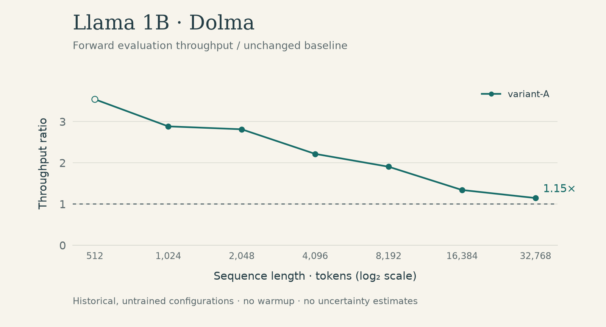
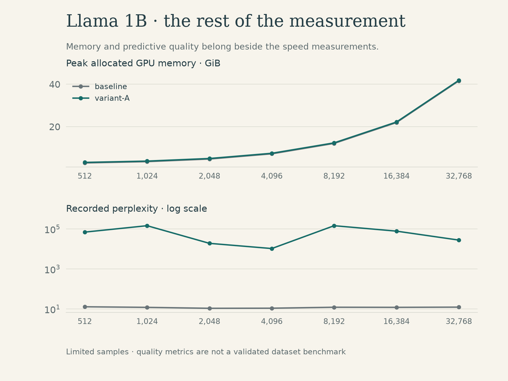

# Llama 1B / Dolma

[Experiment index](../README.md) · [Measurement CSV](measurements.csv) · [Conditions](metadata.json)

`meta-llama/Llama-3.2-1B` on `allenai/dolma:v1_6-sample` · 2026-05-24 UTC · batch 1 · `bf16` · forward evaluation · untrained replacements.

Both configurations produced measurements through 32,768 tokens and allocator failures at 65,536. Higher recorded throughput accompanies severe predictive-quality degradation. At 4,096 tokens, baseline accuracy is 48.67% and variant-A accuracy is 3.39%.

## Throughput and memory

Peak memory is allocated GPU memory in GiB; it is not total device use. Failed rows have no metric values.

| Tokens | Configuration | tok/s | Peak GiB | Status |
| ---: | :--- | ---: | ---: | :--- |
| 512 | baseline | 1,196.30 | 2.93 | measured |
| 512 | variant-A | 4,237.42 | 3.17 | measured |
| 1,024 | baseline | 2,441.35 | 3.54 | measured |
| 1,024 | variant-A | 7,042.73 | 3.79 | measured |
| 2,048 | baseline | 5,023.89 | 4.77 | measured |
| 2,048 | variant-A | 14,136.96 | 5.01 | measured |
| 4,096 | baseline | 8,816.63 | 7.22 | measured |
| 4,096 | variant-A | 19,548.27 | 7.47 | measured |
| 8,192 | baseline | 13,553.01 | 12.13 | measured |
| 8,192 | variant-A | 25,828.51 | 12.38 | measured |
| 16,384 | baseline | 19,603.51 | 21.94 | measured |
| 16,384 | variant-A | 26,281.79 | 22.19 | measured |
| 32,768 | baseline | 21,947.74 | 41.58 | measured |
| 32,768 | variant-A | 25,149.09 | 41.83 | measured |
| 65,536 | baseline | — | — | allocator_failure |
| 65,536 | variant-A | — | — | allocator_failure |

## Recorded predictive quality

Perplexity and accuracy are limited-sample measurements of untrained configurations. A missing accuracy value was not recorded; it is not zero.

| Tokens | Configuration | Loss | Perplexity | Next-token accuracy |
| ---: | :--- | ---: | ---: | ---: |
| 512 | baseline | 2.5567 | 12.89 | 47.36% |
| 512 | variant-A | 11.1496 | 69,536.74 | 0.00% |
| 1,024 | baseline | 2.4895 | 12.06 | 47.61% |
| 1,024 | variant-A | 11.8884 | 145,566.27 | 1.37% |
| 2,048 | baseline | 2.3822 | 10.83 | 48.75% |
| 2,048 | variant-A | 9.8573 | 19,097.13 | 2.34% |
| 4,096 | baseline | 2.3936 | 10.95 | 48.67% |
| 4,096 | variant-A | 9.2587 | 10,495.99 | 3.39% |
| 8,192 | baseline | 2.5039 | 12.23 | 47.25% |
| 8,192 | variant-A | 11.8876 | 145,453.45 | 0.60% |
| 16,384 | baseline | 2.4924 | 12.09 | 47.09% |
| 16,384 | variant-A | 11.2621 | 77,817.84 | 0.10% |
| 32,768 | baseline | 2.5152 | 12.37 | 46.29% |
| 32,768 | variant-A | 10.2319 | 27,774.87 | 1.96% |

## Interpretation boundary

No warmup, limited batches, model reloads, and metric work inside timing make ratios preliminary. Exact configuration mappings and the full-model runner are private. [Protocol](../../docs/measurement-protocol.md) · [Limitations](../../docs/limitations.md) · [Data definitions](../../docs/data-dictionary.md)
