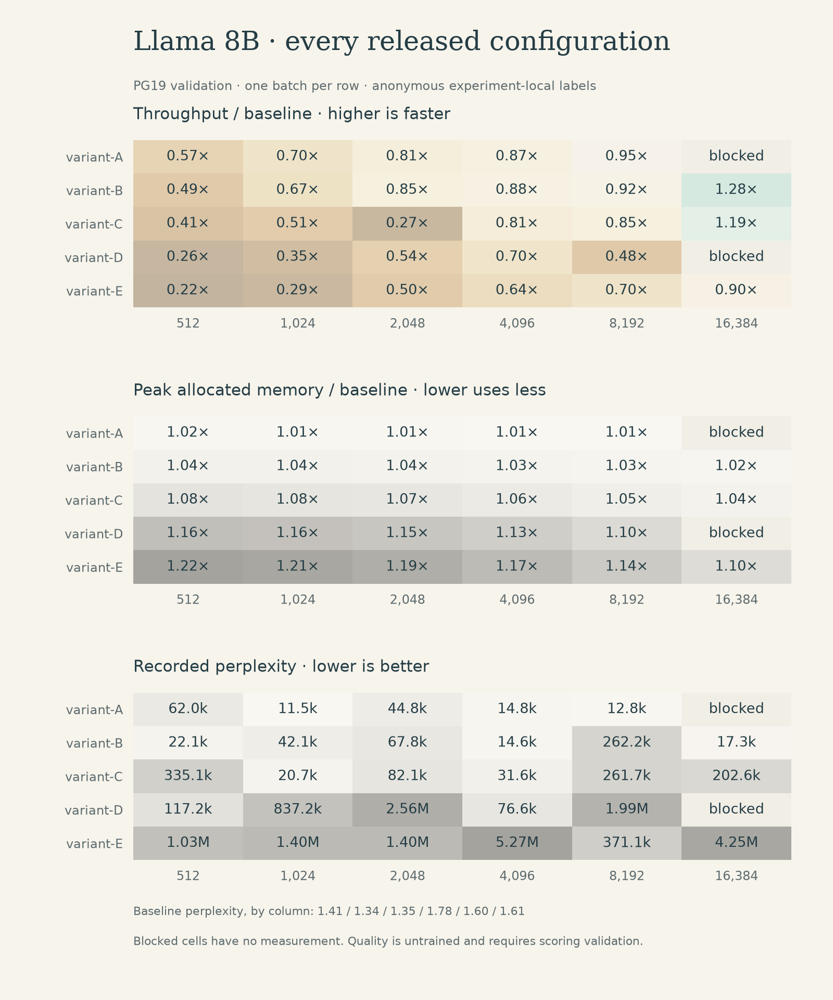

# Llama 8B / PG19

[Experiment index](../README.md) · [Measurement CSV](measurements.csv) · [Conditions](metadata.json)

`meta-llama/Llama-3.1-8B` on `deepmind/pg19` · 2026-05-25 UTC · batch 1 · `bf16` · forward evaluation · untrained replacements.

All six configurations completed through 8,192 tokens. At 16,384, baseline and variants B, C, and E completed; A and D were quota-blocked. There are no completed training results. The dedicated perplexity phase was blocked, but the speed rows already contain loss, perplexity, and accuracy.

Every replacement configuration is slower through 8,192. At 16,384, variants B and C record higher throughput while E remains slower. These are comparisons of entire configurations, not isolated architectural ablations.

The baseline's recorded PG19 perplexity is unusually low (approximately 1.34–1.78). Validation of samples and scoring is needed before any dataset-level quality interpretation. The replacement paths nevertheless show severe degradation on those same sampled inputs.

## Throughput and memory

Peak memory is allocated GPU memory in GiB; it is not total device use. Failed rows have no metric values.

| Tokens | Configuration | tok/s | Peak GiB | Status |
| ---: | :--- | ---: | ---: | :--- |
| 512 | baseline | 12,938.97 | 15.58 | measured |
| 512 | variant-A | 7,369.04 | 15.82 | measured |
| 512 | variant-B | 6,339.23 | 16.22 | measured |
| 512 | variant-C | 5,361.36 | 16.85 | measured |
| 512 | variant-D | 3,374.10 | 18.12 | measured |
| 512 | variant-E | 2,906.73 | 18.96 | measured |
| 1,024 | baseline | 16,911.81 | 16.20 | measured |
| 1,024 | variant-A | 11,800.63 | 16.43 | measured |
| 1,024 | variant-B | 11,321.56 | 16.83 | measured |
| 1,024 | variant-C | 8,604.38 | 17.47 | measured |
| 1,024 | variant-D | 5,836.26 | 18.73 | measured |
| 1,024 | variant-E | 4,842.27 | 19.58 | measured |
| 2,048 | baseline | 16,831.37 | 17.43 | measured |
| 2,048 | variant-A | 13,702.28 | 17.66 | measured |
| 2,048 | variant-B | 14,300.72 | 18.06 | measured |
| 2,048 | variant-C | 4,568.76 | 18.70 | measured |
| 2,048 | variant-D | 9,122.59 | 19.96 | measured |
| 2,048 | variant-E | 8,398.85 | 20.81 | measured |
| 4,096 | baseline | 18,499.38 | 19.89 | measured |
| 4,096 | variant-A | 16,171.72 | 20.13 | measured |
| 4,096 | variant-B | 16,339.78 | 20.52 | measured |
| 4,096 | variant-C | 15,000.28 | 21.16 | measured |
| 4,096 | variant-D | 12,992.17 | 22.43 | measured |
| 4,096 | variant-E | 11,805.72 | 23.27 | measured |
| 8,192 | baseline | 17,104.81 | 24.81 | measured |
| 8,192 | variant-A | 16,201.37 | 25.05 | measured |
| 8,192 | variant-B | 15,761.50 | 25.45 | measured |
| 8,192 | variant-C | 14,531.28 | 26.08 | measured |
| 8,192 | variant-D | 8,215.59 | 27.35 | measured |
| 8,192 | variant-E | 11,955.76 | 28.20 | measured |
| 16,384 | baseline | 11,325.84 | 34.66 | measured |
| 16,384 | variant-B | 14,488.34 | 35.30 | measured |
| 16,384 | variant-C | 13,439.47 | 35.93 | measured |
| 16,384 | variant-E | 10,171.76 | 38.05 | measured |

## Recorded predictive quality

Perplexity and accuracy are limited-sample measurements of untrained configurations. A missing accuracy value was not recorded; it is not zero.

| Tokens | Configuration | Loss | Perplexity | Next-token accuracy |
| ---: | :--- | ---: | ---: | ---: |
| 512 | baseline | 0.3433 | 1.41 | 92.95% |
| 512 | variant-A | 11.0352 | 62,021.03 | 0.00% |
| 512 | variant-B | 10.0019 | 22,068.71 | 0.00% |
| 512 | variant-C | 12.7222 | 335,116.59 | 0.00% |
| 512 | variant-D | 11.6720 | 117,238.28 | 0.00% |
| 512 | variant-E | 13.8443 | 1,029,194.40 | 0.00% |
| 1,024 | baseline | 0.2955 | 1.34 | 93.55% |
| 1,024 | variant-A | 9.3540 | 11,544.85 | 1.27% |
| 1,024 | variant-B | 10.6481 | 42,113.83 | 0.10% |
| 1,024 | variant-C | 9.9383 | 20,708.04 | 1.47% |
| 1,024 | variant-D | 13.6379 | 837,247.16 | 0.00% |
| 1,024 | variant-E | 14.1540 | 1,402,781.85 | 0.00% |
| 2,048 | baseline | 0.2996 | 1.35 | 93.45% |
| 2,048 | variant-A | 10.7093 | 44,768.28 | 0.00% |
| 2,048 | variant-B | 11.1244 | 67,805.22 | 0.00% |
| 2,048 | variant-C | 11.3152 | 82,061.38 | 0.00% |
| 2,048 | variant-D | 14.7554 | 2,559,792.86 | 0.00% |
| 2,048 | variant-E | 14.1523 | 1,400,472.04 | 0.00% |
| 4,096 | baseline | 0.5740 | 1.78 | 87.67% |
| 4,096 | variant-A | 9.6032 | 14,812.20 | 0.07% |
| 4,096 | variant-B | 9.5897 | 14,614.14 | 1.03% |
| 4,096 | variant-C | 10.3612 | 31,610.67 | 0.00% |
| 4,096 | variant-D | 11.2462 | 76,588.96 | 0.00% |
| 4,096 | variant-E | 15.4779 | 5,271,910.43 | 0.00% |
| 8,192 | baseline | 0.4730 | 1.60 | 89.37% |
| 8,192 | variant-A | 9.4582 | 12,812.17 | 1.05% |
| 8,192 | variant-B | 12.4770 | 262,233.02 | 0.10% |
| 8,192 | variant-C | 12.4749 | 261,681.42 | 0.00% |
| 8,192 | variant-D | 14.5032 | 1,989,194.99 | 0.00% |
| 8,192 | variant-E | 12.8243 | 371,124.95 | 0.01% |
| 16,384 | baseline | 0.4752 | 1.61 | 89.10% |
| 16,384 | variant-B | 9.7572 | 17,278.73 | 5.30% |
| 16,384 | variant-C | 12.2189 | 202,578.46 | 0.09% |
| 16,384 | variant-E | 15.2616 | 4,246,640.01 | 0.00% |

## Scheduled throughput coverage

[Coverage CSV](coverage.csv) distinguishes measured, quota-blocked, and unattempted work. It describes run completion only.

| Tokens | Baseline | A | B | C | D | E |
| ---: | :--- | :--- | :--- | :--- | :--- | :--- |
| 512 | measured | measured | measured | measured | measured | measured |
| 1,024 | measured | measured | measured | measured | measured | measured |
| 2,048 | measured | measured | measured | measured | measured | measured |
| 4,096 | measured | measured | measured | measured | measured | measured |
| 8,192 | measured | measured | measured | measured | measured | measured |
| 16,384 | measured | quota blocked | measured | measured | quota blocked | measured |
| 32,768 | quota blocked | not attempted | quota blocked | quota blocked | not attempted | quota blocked |
| 65,536 | not attempted | not attempted | not attempted | not attempted | not attempted | not attempted |
| 131,072 | not attempted | not attempted | not attempted | not attempted | not attempted | not attempted |

## Interpretation boundary

No warmup, limited batches, model reloads, and metric work inside timing make ratios preliminary. Exact configuration mappings and the full-model runner are private. [Protocol](../../docs/measurement-protocol.md) · [Limitations](../../docs/limitations.md) · [Data definitions](../../docs/data-dictionary.md)
